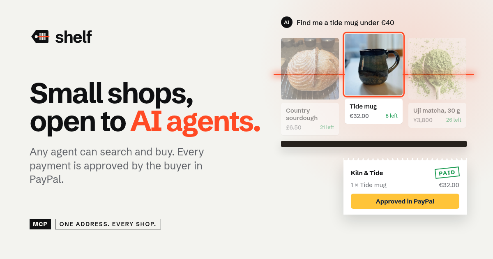

# Shelf

**Small shops, buyable by AI agents.**



Big retailers are already selling to AI agents. The bakery, the potter and the tea shop down the road have no product feed, no API and no engineers, so to an AI they don't exist. Shelf turns a small shop's website, Instagram page, price list or menu photo into a catalogue that any AI agent can search and buy from. The buyer approves every payment in PayPal.

Built for the [PayPal AI Hackathon](https://paypalaihackathon.devpost.com/).

- **Live demo:** https://shelf-pinnaclecryptngs-projects.vercel.app (PayPal sandbox)
- **Watch an agent shop:** https://shelf-pinnaclecryptngs-projects.vercel.app/agent
- **Directory MCP for any agent:** `https://shelf-pinnaclecryptngs-projects.vercel.app/mcp`
- **Demo video:** on the Devpost page

## How it works

1. **Import.** The owner pastes a website or Instagram URL, pastes a price list, or uploads a photo of the menu. Claude extracts the shop profile and every priced item into a structured catalogue. It is told to take only products and prices that are actually there, never to invent them. Each product gets a real, freely licensed photo (Shelf's library or Wikimedia Commons, credited on the storefront), or a plain "Photo coming soon" tile if nothing reliable matches.
2. **Review.** The owner checks and edits every row in an AG Grid table. Channel3 shows what similar products sell for online, so an underpriced item stands out before it goes live.
3. **Publish.** Each product is created in the **PayPal Catalog Products API**, and the shop gets:
   - a storefront at `/s/<shop>`
   - its own MCP server at `/s/<shop>/mcp` (streamable HTTP)
   - `/s/<shop>/llms.txt` and `/s/<shop>/feed.json`
   - a listing in the directory MCP at `/mcp`, which covers every shop
4. **An agent buys.** Any MCP client (Claude, ChatGPT, Cursor or Shelf's built-in agent) uses `find_shops`, `search_all_products`, `get_shop_info`, `search_products`, `create_checkout` and `get_order_status`. `create_checkout` creates a **PayPal order** (intent `CAPTURE`) whose total is worked out on the server from the shop's prices and stock, and returns an `approve_url`.
5. **A person approves.** Money moves only after the buyer approves in PayPal. Shelf captures the order on return (and from the webhook), marks it `PAID`, takes the items out of stock and pushes the event to the owner's live dashboard. The agent calls `get_order_status` and only says "paid" once Shelf does.
6. **The owner runs the shop with a copilot.** The dashboard shows revenue, orders, what was bought by agents and what agents searched for. The copilot, built on the **PayPal Agent Toolkit**, answers questions, adds shipment tracking and issues refunds. Refunds and tracking wait for the owner to press **Approve**.

The demo agent at `/agent` connects to Shelf's public `/mcp` endpoint with `@ai-sdk/mcp`, exactly as an outside agent would.

## How Shelf uses PayPal

All PayPal calls run against the **sandbox**.

| PayPal tool | What it does in Shelf |
| --- | --- |
| Orders v2 API (create, get, capture) | Agent and storefront checkouts. The server sets the total; the buyer approves in PayPal; Shelf captures. |
| Catalog Products API | Every published product is created as a PayPal catalogue product. |
| Payments API (refunds) | Full refunds of captured payments from the owner's copilot. |
| Order tracking API | Adds shipment tracking to paid orders. |
| Webhooks + signature verification | `CHECKOUT.ORDER.APPROVED` and `PAYMENT.CAPTURE.COMPLETED` confirm payments; refunds made directly in PayPal sync back to Shelf. Every webhook is signature-checked. |
| PayPal Agent Toolkit (`@paypal/agent-toolkit`) | The merchant copilot: `create_shipment_tracking`, `create_refund`, `get_order`, `list_transactions`, `get_merchant_insights`. |

## How Shelf uses AI

| AI tool | What it does in Shelf |
| --- | --- |
| Claude Sonnet 4.5 (Anthropic), via the Vercel AI SDK | Catalogue import (structured output from websites, Instagram pages, text and menu photos), the shopping agent at `/agent`, and the merchant copilot (tool calling with approval). |
| Google Gemini | Automatic fallback model if no Anthropic key is set. |
| Model Context Protocol (`@modelcontextprotocol/sdk`, `@ai-sdk/mcp`) | Per-shop and directory MCP servers so any AI agent can search Shelf and check out. |

## Sponsor tools

- **AG Grid (Community):** the editable grid where owners review and fix the AI's draft before publishing, and the sortable products table on the dashboard (price, units sold, low stock, PayPal Catalog sync).
- **Channel3:** during import, every drafted product is searched on Channel3 in the shop's market and currency. The grid shows the going price range and whether the owner's price is above, below or on par.

## Guardrails

- **Agents can't pay.** Every order needs a person to approve it in PayPal.
- **People approve.** The copilot's refunds and tracking need the owner's Approve. The public demo dashboards are view-only and hide buyer details.
- **Prices come from the shop.** Agents send product IDs and quantities only. Totals come from the database, so a prompt can't change what's charged.
- **Stock is held.** The last item can't sell twice, cancelled orders are never charged, and checkouts nobody approves expire after 6 hours.
- **Shop text is data.** Product and shop text reaches agents as data, never as instructions.
- An order only counts as `PAID` after PayPal's capture returns `COMPLETED`.
- The importer fetches public http(s) addresses only, blocks private IPs (including after redirects) and caps downloads at 2 MB.
- Import, shop creation, publishing, checkout, the agent, MCP and AI usage are rate-limited, with a daily AI cap.
- In production Shelf fails closed without PayPal keys; the fake-payment page exists only in development.

## Try it (judges)

1. **Buy through an AI agent.** Open [/agent](https://shelf-pinnaclecryptngs-projects.vercel.app/agent) and ask "Find me a handmade mug as a gift, under €40". Click **Approve in PayPal** and log in with a PayPal sandbox Personal account. On the receipt, click **Back to the agent** and it confirms the order is PAID.
2. **Use your own agent.** Add `https://shelf-pinnaclecryptngs-projects.vercel.app/mcp` as a remote MCP server in Claude, ChatGPT or Cursor.
3. **Open a shop.** Go to **Open your shop** → **Paste a list** → **Use a sample menu** (or paste a real shop's website). Review the AG Grid table with Channel3 prices and publish. You become that shop's owner, so its dashboard and copilot are fully usable.

The demo shops are Fernhill Bakehouse (Bristol), Kiln & Tide (Lisbon), Mori Tea Works (Kyoto) and Marigold Kitchen (Toronto). Their dashboards are view-only for the public.

## Run locally

Requires Node.js 22 (the version CI uses).

```bash
git clone https://github.com/PinnacleCryptNG/shelf.git
cd shelf
cp .env.example .env.local   # add PayPal sandbox + AI keys
npm install
npm run dev                  # http://localhost:3000
```

With no `DATABASE_URL`, Shelf uses embedded PGlite in `./.data/pg` and seeds three demo shops (Bristol, Lisbon, Kyoto). With no PayPal keys in development, it runs in **mock mode**: orders get `MOCK-` IDs and a local approval page, so the whole flow works offline.

Connect an agent to your local copy:

```json
{ "mcpServers": { "shelf": { "url": "http://localhost:3000/mcp" } } }
```

### Environment variables

| Variable | Purpose |
| --- | --- |
| `PAYPAL_CLIENT_ID`, `PAYPAL_CLIENT_SECRET` | PayPal sandbox app (developer.paypal.com → Apps & Credentials). |
| `PAYPAL_ENVIRONMENT` | `SANDBOX`. |
| `PAYPAL_WEBHOOK_ID` | Webhook for signature verification. Subscribe to `CHECKOUT.ORDER.APPROVED`, `PAYMENT.CAPTURE.COMPLETED` and `PAYMENT.CAPTURE.REFUNDED`, pointing at `/api/paypal/webhook`. |
| `ANTHROPIC_API_KEY` | Claude (used first). Optional `ANTHROPIC_MODEL` overrides `claude-sonnet-4-5`. |
| `GOOGLE_GENERATIVE_AI_API_KEY` | Gemini fallback. |
| `DATABASE_URL` or `POSTGRES_URL` | Postgres/Neon. Leave empty for PGlite. |
| `NEXT_PUBLIC_SITE_URL` | Public URL used in MCP endpoints and PayPal return links. |
| `CHANNEL3_API_KEY` | Optional market-price check during import. |
| `DEMO_OWNER_KEY`, `SHELF_DEMO_KEY` | Owner key for the seeded demo shops' dashboards. |
| `SHELF_AI_DAILY_LIMIT` | Daily cap on AI calls (default 1500). |

### Checks

```bash
npm run lint
npm run typecheck
npm test
```

CI runs all three on every push.

## Stack

Next.js 15 (App Router) · React 19 · TypeScript · Tailwind CSS 4 · Vercel AI SDK (Anthropic, Google) · `@modelcontextprotocol/sdk` · `@paypal/agent-toolkit` · PayPal REST (Orders v2, Catalog Products, Payments, Tracking, Webhooks) · AG Grid Community · Channel3 · Postgres (Neon) or embedded PGlite · Vercel.

## Limits

- Every payment goes to one Shelf PayPal account. Per-shop payouts need PayPal partner onboarding and aren't built yet.
- Product photos show the right kind of product but aren't the demo shops' own goods, since the shops are fictional. Credits are in [`public/products/CREDITS.md`](public/products/CREDITS.md).

## License

[MIT](LICENSE)
